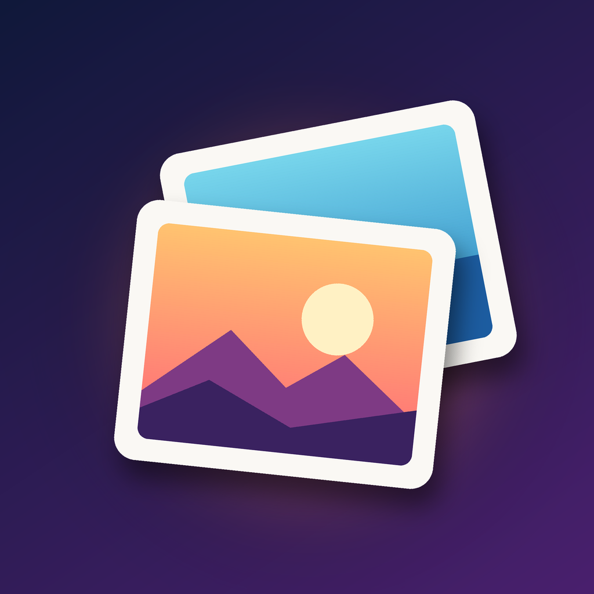

<p align="center">
  
</p>

<h1 align="center">Memories TV</h1>

<p align="center">
  Your <a href="https://memories.gallery/">Nextcloud Memories</a> photo and video library on your LG TV,<br>
  built to be browsed from the couch with the remote.
</p>

<p align="center">
  <a href="LICENSE"></a>
</p>

> **Version 0.9.** Every section of Memories' web app works except Explore, Map and Trash. Memories TV only reads your library: nothing on your server is changed.
> There are no releases yet: install it by building from source.

Memories TV is a fork of [immich-tv-webos](https://github.com/Seeky91/immich-tv-webos) by Quentin Jean-Amans. The TV interface is theirs; the data layer, sign-in and media handling were replaced to talk to Nextcloud Memories instead of Immich.

## ✨ Features

- 🖼️ **Timeline**: your whole Memories library, day by day, in a justified grid that keeps every photo's shape. A date scrubber on the right jumps straight to any month or year.
- 🧭 **Memories' sections**, in the same order as its web app:
  - **Folders**: browse your folders from the Folders path set in Memories, with or without subfolders.
  - **Favourites**: the photos and videos you starred.
  - **Albums**: your own and shared albums.
  - **People**: faces from [Recognize](https://apps.nextcloud.com/apps/recognize) or [Face Recognition](https://apps.nextcloud.com/apps/facerecognition).
  - **Archive**: photos you archived in Memories, which the timeline hides.
  - **On this day**: photos taken on today's date in past years.
  - **Places**: photos grouped by where they were taken.
  - **Tags**: Nextcloud's collaborative tags.
- 🔍 **Full-screen viewer**: controls that fade away to leave the photo alone, and a rotate button for sideways shots (a local viewing preference: nothing is written to your server).
- 📷 **RAW files**: a RAW badge on RAW photos. With Memories' *Stack RAW files with same name* on, a RAW file is hidden behind the JPG or HEIC of the same name, which gets the badge.
- ▶️ **Videos**: played from the original file, with seeking. No transcoding needed on the server.
- 🎞️ **Slideshow**: crossfades, shuffle, adjustable interval, and the TV screen saver stays away while it runs.
- 📱 **Sign in with your phone**: scan a QR code and approve the TV in your phone's browser. Your password is never typed on the TV, and two-factor authentication and single sign-on work as usual.
- 👥 **Several accounts**: add servers or family members and switch between them.
- 🎮 **Made for the remote**: every screen works with the arrow keys; the Magic Remote pointer and scroll wheel work too.

Not yet: Explore, Map and Trash.

## 📋 Requirements

**TV**
- An LG webOS TV whose web engine is **Chrome 132 or newer**. Memories TV is developed and tested on an LG OLED77G48LW (webOS SDK 11.2). Older TVs are not supported.
- [Developer Mode](https://webostv.developer.lge.com/develop/getting-started/developer-mode-app) enabled, to install the app.

**Server**
- **Nextcloud** with the **[Memories](https://apps.nextcloud.com/apps/memories)** app installed and enabled.
- Reachable from the TV over **HTTPS with a publicly trusted certificate** (for example Let's Encrypt). The TV rejects self-signed certificates.
- **Video previews enabled** in Nextcloud, for video thumbnails. Memories uses Nextcloud's previews, and for videos these need [ffmpeg](https://ffmpeg.org/) on the server and the `OC\Preview\Movie` preview provider (or video previews switched on in the Memories admin settings). Without them, video tiles show "Preview unavailable"; the videos themselves still play.
- No CORS or reverse-proxy changes are needed.

**Supported formats**

- **Photos** are shown as previews made by Nextcloud, so any photo Nextcloud and Memories can preview works. Tested: JPG, HEIC, and RAW (DNG from a Galaxy S24). If HEIC or RAW photos show "Preview unavailable", check Nextcloud's preview settings.
- **Photo resolution:** full-screen photos are previews of at most 1920×1080, not the original files. That is all a webOS app can show: on UHD TVs, LG draws web apps at 1920×1080 and the TV scales them up to the panel; only video plays at full 4K ([LG: Supported App Resolution](https://webostv.developer.lge.com/develop/specifications/app-resolution)). A larger image would be scaled down again before it reaches the screen, while taking longer to load and more memory. If photos look soft or blocky, see [Photos look soft or blocky](#photos-look-soft-or-blocky).
- **Videos** play from the original file, without transcoding (Memories' go-vod is not used), so the TV has to support the format. Tested: MP4 with H.264 or HEVC, including **HDR** HEVC video from a Galaxy S24 (the TV switches to HDR), and portrait video. The TV also reports support for VP9 and AV1, not yet tried with real files.
- **MOV files**, such as iPhone videos, may not play: the TV reports no support for the MOV container. Not yet tried with real files.
- **Live and motion photos** show as still photos; playing the motion part isn't supported yet.

## 📥 Installation

There is no release or Homebrew Channel package yet. Build the app and install it on a TV in Developer Mode:

1. Install [Node.js](https://nodejs.org/) 20 or newer, the [Enact CLI](https://enactjs.com/docs/developer-tools/cli/) and the [webOS CLI](https://webostv.developer.lge.com/develop/tools/cli-installation/):
   ```bash
   npm install -g @enact/cli @webos-tools/cli
   ```
   To install global packages without root, point npm at your home directory first (as the [npm docs](https://docs.npmjs.com/resolving-eacces-permissions-errors-when-installing-packages-globally) recommend): `npm config set prefix ~/.local`, and make sure `~/.local/bin` is on your `PATH`.
2. Register your TV with the webOS CLI (`ares-setup-device`). The Makefile expects the device name `LG_TV`; use `DEVICE=<name>` for another one.
3. Build, install and launch:
   ```bash
   git clone https://github.com/Whisprin/memories-tv-webos.git
   cd memories-tv-webos
   npm ci
   make pack install launch
   ```

## 🔑 Signing in

1. Enter your Nextcloud address, for example `https://cloud.example.com` (include the subfolder if Nextcloud lives in one, such as `https://example.com/nextcloud`). The app checks that Memories is installed.
2. Scan the QR code with your phone, sign in to Nextcloud and choose **Grant access**. The address under the code works on any device too.
3. The TV continues by itself and opens your timeline.

The app gets its own app password, listed as **Memories TV** under Nextcloud → **Settings → Security**. Revoking it there signs the TV out. Removing the account on the TV revokes it as well.

## 🛟 Troubleshooting

### "Couldn't reach the server" while signing in

Check the address, that the TV is online, and that the server's HTTPS certificate is publicly trusted. A self-signed certificate is the most common cause.

### "Can't connect to Nextcloud" when the app starts

The TV is offline, or your server is down or in maintenance mode. The message says which. Choose **Try again** once it's back; if the TV was offline, the app tries again by itself when it reconnects. **Accounts** lets you switch to another account in the meantime.

### "Nextcloud Memories was not found at this address"

Memories isn't installed or enabled for your user, or the address is missing the subfolder Nextcloud is installed in.

### The QR link opens the wrong address on my phone

Nextcloud builds the sign-in link from its own configuration, `overwrite.cli.url` and `overwritehost` in `config.php`. If that names a host your phone can't reach, the TV shows a warning under the code. Fix those settings, or open the link manually with the right host.

### Videos show "Preview unavailable"

Video previews are disabled in Nextcloud. Enable them as described under [Requirements](#-requirements). Existing videos get their thumbnail the first time the app shows them.

### Photos look soft or blocky

Full-screen photos are already as sharp as a webOS app can show them (see [Supported formats](#-requirements)), so the likely cause is the JPEG quality of Nextcloud's previews. Raise it on the server, for example to 90:

```bash
occ config:app:set preview jpeg_quality --value=90
```

Previews Nextcloud has already made keep their old quality; new ones use the new value.

### "The server rejected the sign-in"

The app password was revoked or has expired. Open the account menu and sign in again.

### People, Places or Tags are empty

Each needs something on the server: **People** needs Recognize or Face Recognition to have found faces, **Places** needs photos with a location and Memories' places set up (reverse geocoding), and **Tags** needs Nextcloud's collaborative tags on your photos.

## 🛠️ Development

```bash
npm run serve      # dev server with hot reload (desktop browser)
npm run lint       # ESLint
npm run typecheck  # tsc --noEmit
npm test           # unit tests
npm run pack-p     # production build into dist/
make pack          # build the .ipk (app + service)
make install       # install it on the TV (DEVICE, default LG_TV)
make launch        # launch it
make inspect       # open the Web Inspector for the app on the TV
```

In a desktop browser the timeline loads, but images and videos don't: they go through the helper service, which only runs on the TV (see below).

After changing the app icon (`tools/make_icon.py`), restart the TV (unplug it for about a minute): webOS caches launcher icons, and neither reinstalling nor a new version refreshes them.

### Architecture

A layered React app built with [Enact](https://enactjs.com/) and [Sandstone](https://enactjs.com/docs/modules/sandstone/):

- **`src/domain/`**: the `PhotoRepository` interface the UI depends on, and its React context.
- **`src/api/`**: `MemoriesRepository` (Memories' day-based timeline mapped to month buckets), the Nextcloud HTTP client (app password as Basic auth plus `OCS-APIRequest`, no cookies) and Login Flow v2.
- **`src/platform/`**: the client for the app's own webOS service.
- **`src/hooks/`**: [TanStack Query](https://tanstack.com/query) wrappers for data, plus accounts and webOS UI hooks.
- **`src/views/` and `src/components/`**: the TV UI, navigated with the webOS Spotlight (D-pad) focus system.
- **`service/`**: a small webOS JS service (Node, no dependencies) packaged with the app. It does what the web app can't:
  - **`loginFlowInit`** starts the Nextcloud sign-in with `User-Agent: Memories TV`, so the app password carries the app's name (`fetch` can't set that header).
  - **`mediaProxy`** runs HTTP servers on `127.0.0.1` that add the `Authorization` header Nextcloud needs, since `` and `<video>` can't send it. Thumbnail requests arriving together are fetched as one Memories `multipreview`; previews it skips are fetched one by one so Nextcloud generates them. Video passes `Range` through for seeking. The proxy listens on several ports, because the browser opens at most 6 connections per host and port.

The app runs as a packaged `file://` page and calls Nextcloud directly. `appinfo.json` sets `vendorExtension.allowCrossDomain`, which lets it do so on the supported TVs without CORS headers on the server.

## ⚖️ Disclaimer

Memories TV is an unofficial, third-party client. It is not affiliated with or endorsed by Nextcloud, the Memories project, or Immich. Provided as-is for personal use on LG TVs.

## 📄 License

MIT © Robert Sprunk. Based on [immich-tv-webos](https://github.com/Seeky91/immich-tv-webos) © Quentin Jean-Amans. See [LICENSE](LICENSE).
