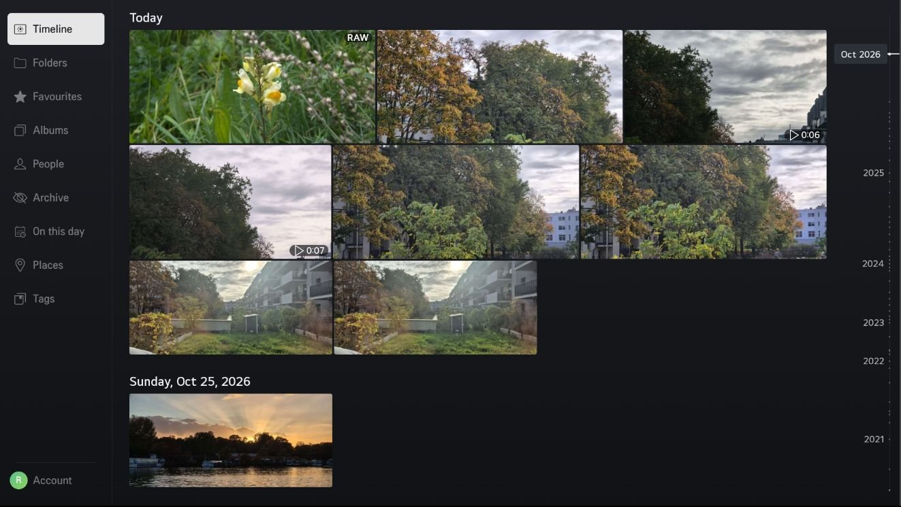

<p align="center">
  
</p>

<h1 align="center">Memories TV</h1>

<p align="center">
  Your <a href="https://memories.gallery/">Nextcloud Memories</a> photo and video library on your LG TV,<br>
  built to be browsed from the couch with the remote.
</p>

<p align="center">
  <a href="https://github.com/Whisprin/memories-tv-webos/releases/latest"></a>
  <a href="https://github.com/Whisprin/memories-tv-webos/releases"></a>
  <a href="#requirements"></a>
  <a href="LICENSE"></a>
</p>

> Every section of Memories' web app works except Explore and Trash. Memories TV only reads your library and never changes anything on your server. The [changelog](CHANGELOG.md) lists what's new.

<p align="center">
  
</p>

Memories TV started as a fork of [immich-tv-webos](https://github.com/Seeky91/immich-tv-webos) by Quentin Jean-Amans. Its TV interface was the starting point and has been reworked since. The data layer, sign-in and media handling were replaced so the app talks to Nextcloud Memories instead of Immich.

## Features

- The timeline shows your whole Memories library day by day, in a justified grid that keeps each photo's shape. A date scrubber on the right jumps to any month or year.
- The other sections of Memories come in the same order as in its web app:
  - Folders: your folders, starting from the Folders path set in Memories, with or without subfolders.
  - Favourites: the photos and videos you starred.
  - Albums: your own albums and the ones shared with you.
  - People: faces found by [Recognize](https://apps.nextcloud.com/apps/recognize) or [Face Recognition](https://apps.nextcloud.com/apps/facerecognition).
  - Archive: photos you archived in Memories, which the timeline hides.
  - On this day: photos taken on today's date in past years.
  - Places: photos grouped by where they were taken.
  - Map: where your photos were taken, with the photos of the visible area beside it (see [below](#map)).
  - Tags: Nextcloud's collaborative tags.
- In the full-screen viewer, the controls fade out after a moment. The Info panel shows place, people, tags, camera, exposure and file details. The 4K button shows a photo at the TV's full resolution (see below), and the rotate button turns sideways shots. Rotation is only remembered on the TV; nothing is written to your server.
- RAW photos get a RAW badge. If *Stack RAW files with same name* is on in Memories, a RAW file is hidden behind the JPG or HEIC of the same name, and that photo gets the badge instead.
- Videos play from the original file, and you can seek. The server doesn't have to transcode anything.
- The slideshow has crossfades, shuffle and an adjustable interval, and keeps the TV's screen saver off while it runs.
- You sign in with your phone: scan a QR code and approve the TV in your phone's browser. You never type your password on the TV, and two-factor authentication and single sign-on work as usual.
- You can add several servers or family members and switch between them.
- Every screen works with the remote's arrow keys. The Magic Remote's pointer and scroll wheel work too.

### Map

The Map tab shows the map on the left. On the right is a timeline of the photos inside the visible area, which updates as you move the map.

- On the map, the arrow keys pan (hold one down to pan faster), CH ▲ and CH ▼ zoom, and OK moves to the photos.
- Back on the photos returns to the map. Back on the map goes to the menu.
- With the Magic Remote pointer, drag to pan, scroll to zoom, and click a marker to zoom in on it.
- Settings has three map styles: OpenStreetMap, a dimmed version of it for dark rooms, and OpenTopoMap.

The map tiles come from [OpenStreetMap](https://www.openstreetmap.org/copyright) (or [OpenTopoMap](https://opentopomap.org/)). As the tile servers ask, the app's service on the TV fetches them with the app's name in the request and caches them for at least a week. The tile server sees your TV's internet address and which parts of the world you look at. Your photos and their locations never leave your Nextcloud.

## Requirements

**TV**
- An LG TV with webOS TV 23 or newer (2023 models onwards, with a web engine of Chromium 94 or newer). Memories TV is developed on an LG OLED77G48LW (webOS TV 26) and also tested on webOS TV 23. Older TVs haven't been tested. Which video formats play depends on the TV's hardware.
- [Developer Mode](https://webostv.developer.lge.com/develop/getting-started/developer-mode-app) turned on, to install the app.

**Server**
- Nextcloud with the [Memories](https://apps.nextcloud.com/apps/memories) app installed and enabled.
- HTTPS with a publicly trusted certificate (for example from Let's Encrypt), reachable from the TV. The TV rejects self-signed certificates.
- Video previews turned on in Nextcloud, for video thumbnails. Memories uses Nextcloud's previews, and for videos these need [ffmpeg](https://ffmpeg.org/) on the server and the `OC\Preview\Movie` preview provider (or video previews switched on in the Memories admin settings). Without them, video tiles show "Preview unavailable", though the videos still play.
- You don't need to change CORS or your reverse proxy.

**Supported formats**

- Photos are shown as previews made by Nextcloud, so any photo Nextcloud and Memories can preview works. Tested so far: JPG, HEIC, and RAW (DNG from a Galaxy S24). If HEIC or RAW photos show "Preview unavailable", check Nextcloud's preview settings.
- Full-screen photos are previews of at most 1920×1080, not the original files, because that's the most a webOS app can show. On UHD TVs, LG draws web apps at 1920×1080 and scales them up to the panel; only video plays at full 4K ([LG: Supported App Resolution](https://webostv.developer.lge.com/develop/specifications/app-resolution)). A larger image would be scaled back down before it reached the screen, and would take longer to load and use more memory. If photos look soft or blocky, see [Photos look soft or blocky](#photos-look-soft-or-blocky).
- The 4K button in the photo viewer hands the photo, and up to 49 photos after it, to the TV's own Media Player, which shows them at the panel's full resolution. Page through them with the player's arrow keys, and press Back to return to Memories TV. JPG and HEIC photos are shown from the original file. RAW photos (such as DNG) are shown as the JPEG that Memories converts them to on the server, and their colours can look off, because that conversion doesn't match how the camera makes its own JPEGs. With *Stack RAW files with same name* on, a RAW file stacked behind a JPG is shown as that JPG.
- Videos play from the original file without transcoding (Memories' go-vod isn't used), so the TV has to support the format. Tested so far: MP4 with H.264 or HEVC, including HDR HEVC video from a Galaxy S24 (the TV switches to HDR) and portrait video. The TV also reports support for VP9 and AV1, which haven't been tried with real files yet.
- MOV files, such as iPhone videos, may not play: the TV reports no support for the MOV container. This hasn't been tried with real files yet.
- Live and motion photos show as still photos. Playing the motion part isn't supported yet.

## Installation

You install the app with the [webOS CLI](https://webostv.developer.lge.com/develop/tools/cli-installation/) on a TV in [Developer Mode](https://webostv.developer.lge.com/develop/getting-started/developer-mode-app). Once it's [included in the Homebrew Channel's apps repository](https://github.com/webosbrew/apps-repo/pull/308), you'll be able to install it from the Homebrew Channel instead. It isn't in LG's store.

### From a release

1. Install the webOS CLI and register your TV with it (`ares-setup-device`).
2. Download the `.ipk` file from the [latest release](https://github.com/Whisprin/memories-tv-webos/releases/latest).
3. Install it:
   ```bash
   ares-install --device <your TV> eu.whisprin.memoriestv_<version>_all.ipk
   ```

### From source

1. Install [Node.js](https://nodejs.org/) 24 or newer, the [Enact CLI](https://enactjs.com/docs/developer-tools/cli/) and the [webOS CLI](https://webostv.developer.lge.com/develop/tools/cli-installation/):
   ```bash
   npm install -g @enact/cli @webos-tools/cli
   ```
   To install global packages without root, point npm at your home directory first, as the [npm docs](https://docs.npmjs.com/resolving-eacces-permissions-errors-when-installing-packages-globally) recommend: `npm config set prefix ~/.local`. Then make sure `~/.local/bin` is on your `PATH`.
2. Register your TV with the webOS CLI (`ares-setup-device`). The Makefile expects the device name `LG_TV`; use `DEVICE=<name>` for another one.
3. Build, install and launch:
   ```bash
   git clone https://github.com/Whisprin/memories-tv-webos.git
   cd memories-tv-webos
   npm ci
   make pack install launch
   ```

## Signing in

1. Enter your Nextcloud address, for example `https://cloud.example.com`. If Nextcloud lives in a subfolder, include it, as in `https://example.com/nextcloud`. The app checks that Memories is installed.
2. Scan the QR code with your phone, sign in to Nextcloud and choose **Grant access**.
3. The TV carries on by itself and opens your timeline.

The app gets its own app password, listed as "Memories TV" under Nextcloud → **Settings → Security**. Revoking it there signs the TV out. Removing the account on the TV revokes it too.

## Troubleshooting

### "Couldn't reach the server" while signing in

Check the address, check that the TV is online, and check that the server's HTTPS certificate is publicly trusted. A self-signed certificate is the most common cause.

### "Can't connect to Nextcloud" when the app starts

Either the TV is offline or your server is down or in maintenance mode, and the message says which. Choose **Try again** once it's back. If the TV was offline, the app tries again by itself when it reconnects. In the meantime, **Accounts** lets you switch to another account.

### "Nextcloud Memories was not found at this address"

Memories isn't installed or enabled for your user, or the address is missing the subfolder Nextcloud is installed in.

### The QR link opens the wrong address on my phone

Nextcloud builds the sign-in link from `overwrite.cli.url` and `overwritehost` in its `config.php`. If those name a host your phone can't reach, the TV shows a warning under the code. Fix the settings, then choose **Cancel** and sign in again to get a new code.

### Videos show "Preview unavailable"

Video previews are turned off in Nextcloud. Turn them on as described under [Requirements](#requirements). Existing videos get their thumbnail the first time the app shows them.

### Photos look soft or blocky

Full-screen photos are already as sharp as a webOS app can show them (see [Supported formats](#requirements)). For full resolution, use the **4K** button. Otherwise, the JPEG quality of Nextcloud's previews is probably too low. Raise it on the server, for example to 90:

```bash
occ config:app:set preview jpeg_quality --value=90
```

Previews Nextcloud has already made keep their old quality; only new ones use the new value.

### "The server rejected the sign-in"

The app password was revoked or has expired. Open **Settings** and sign in again.

### People, Places, Map or Tags are empty

Each of these needs something on the server. People needs Recognize or Face Recognition to have found faces. Places needs photos with a location and Memories' places set up (reverse geocoding). The Map needs photos with a location that Memories has indexed. Tags needs Nextcloud's collaborative tags on your photos.

## Development

```bash
npm run serve      # dev server with hot reload (desktop browser)
npm run lint       # ESLint
npm run typecheck  # tsc --noEmit
npm test           # unit tests
npm run pack-p     # production build into dist/
make pack          # build the .ipk (app + service)
make install       # install it on the TV (DEVICE, default LG_TV)
make launch        # launch it
make inspect       # open the Web Inspector for the app on the TV
```

In a desktop browser the timeline loads, but images and videos don't, because they go through the helper service, which only runs on the TV (see below).

After changing the app icon (`tools/make_icon.py`), restart the TV by unplugging it for about a minute. webOS caches launcher icons, and neither reinstalling nor a new version refreshes them.

### Architecture

The app is a layered React app built with [Enact](https://enactjs.com/) and [Sandstone](https://enactjs.com/docs/modules/sandstone/):

- `src/domain/` has the `PhotoRepository` interface the UI depends on, and its React context.
- `src/api/` has `MemoriesRepository` (which maps Memories' day-based timeline to month buckets), the Nextcloud HTTP client (app password as Basic auth plus `OCS-APIRequest`, no cookies) and Login Flow v2.
- `src/platform/` has the client for the app's own webOS service.
- `src/hooks/` has [TanStack Query](https://tanstack.com/query) wrappers for data, plus hooks for accounts and the webOS UI.
- `src/views/` and `src/components/` are the TV UI, navigated with webOS Spotlight (D-pad) focus.
- `service/` is a small webOS JS service (Node, no dependencies) packaged with the app. It handles two things the web app can't:
  - `loginFlowInit` starts the Nextcloud sign-in with `User-Agent: Memories TV`, so the app password carries the app's name. `fetch` can't set that header.
  - `mediaProxy` runs HTTP servers on `127.0.0.1` that add the `Authorization` header Nextcloud needs, since `` and `<video>` can't send it. Thumbnail requests that arrive together are fetched as one Memories `multipreview`, and any previews it skips are fetched one by one so Nextcloud generates them. For video, it passes `Range` through so seeking works. The proxy listens on several ports because the browser opens at most 6 connections per host and port. It also serves the Map's tiles (`tiles.js`), with the app's name in the `User-Agent` and a disk cache with a size limit.

The app runs as a packaged `file://` page and calls Nextcloud directly. `appinfo.json` sets `vendorExtension.allowCrossDomain`, which lets it do that on the supported TVs without CORS headers on the server.

## Disclaimer

Memories TV is an unofficial third-party client. It is not affiliated with or endorsed by Nextcloud, the Memories project, or Immich. It is provided as-is for personal use on LG TVs.

## License

MIT © Robert Sprunk. Based on [immich-tv-webos](https://github.com/Seeky91/immich-tv-webos) © Quentin Jean-Amans. See [LICENSE](LICENSE).
